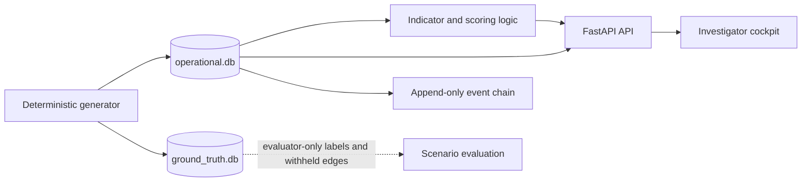

# SENTINEL//TRACE

SENTINEL//TRACE is a local, synthetic insurance-fraud investigation prototype. It models claims, claimants, policies, incidents, providers, invoices, payments, relationships, and investigator cases so that a reviewer can trace why a claim was flagged and follow the case through a simple workflow.

This is a candidate-project repository, not a production claims system. It uses generated data only, has no authentication layer, and should be run locally.

## What it does

- Generates a deterministic synthetic insurance portfolio from a seed.
- Stores operational data and evaluator-only ground truth in separate SQLite databases.
- Builds a relationship graph from observable operational data.
- Produces explainable fraud indicators and claim risk tiers.
- Serves a FastAPI API and a browser-based investigator cockpit.
- Records lifecycle events in an append-only, hash-linked event log.

## Architecture



The key boundary is intentional: `ground_truth.db` is for evaluation. It holds labels, ring membership, and withheld edges that the operational API and scoring path must not use. The application works from `operational.db` only.

The operational schema has 12 SQLite `STRICT` tables and integrity triggers. The schema, constraints, and permitted values are defined in [`archive/verify-0103/ops_0103.sql`](archive/verify-0103/ops_0103.sql) and [`archive/verify-0103/trigs_0103.sql`](archive/verify-0103/trigs_0103.sql). A readable table guide is available in [`docs/DATA_DICTIONARY.md`](docs/DATA_DICTIONARY.md).

## Main components

| Area | Location | Responsibility |
| --- | --- | --- |
| Dataset generator | `db/seed.py` | Builds the deterministic operational and ground-truth databases. |
| Generation command | `scripts/generate_dataset.py` | Validates target paths and runs the generator. |
| Backend | `backend/app/` | FastAPI application, API endpoints, database sessions, and cockpit template. |
| Operational schema | `archive/verify-0103/` | SQLite tables, constraints, and triggers. |
| Tests | `backend/tests/`, `db/` | API, schema, chronology, trigger, isolation, and workflow checks. |

## Scoring and review flow

The generator evaluates 15 indicators across network, financial, behavioural, and document pillars. Indicator rows carry an evidence token, points, severity, and a canonical feature snapshot. Scores are calculated from the stored operational indicators, then placed into `LOW`, `MEDIUM`, `HIGH`, or `CRITICAL` tiers.

Benign contexts can dampen a score. For example, BC-1 covers a high-density residential address without independent fraud evidence. Its multiplier is `0.35` in the specification, canonical generator, and modular scorer. When several benign contexts apply, the generator uses the documented product rule with a `0.15` lower bound.

The hash-linked event chain is an integrity and ordering mechanism. It is not proof of authorship, identity, or non-repudiation because it is not signed or keyed.

## Quick start

### Prerequisites

- Python 3.11, 3.12, or 3.13
- SQLite with `STRICT` table support

Install dependencies:

```bash
python -m pip install -r backend/requirements.txt
```

Generate a disposable local fixture. Use new paths; the generator refuses existing files unless `--overwrite` is deliberately passed.

```bash
python scripts/generate_dataset.py \
  --op-db .test-tmp/operational.db \
  --gt-db .test-tmp/ground_truth.db
```

Start the API against that operational database.

PowerShell:

```powershell
$env:SENTINEL_DB_PATH = ".test-tmp/operational.db"
python -m uvicorn backend.app.main:app --port 8000
```

macOS/Linux shell:

```bash
SENTINEL_DB_PATH=.test-tmp/operational.db python -m uvicorn backend.app.main:app --port 8000
```

Open:

- Cockpit: `http://127.0.0.1:8000/`
- API health: `http://127.0.0.1:8000/api/v1/health`
- OpenAPI docs: `http://127.0.0.1:8000/docs`

## API overview

| Endpoint | Purpose |
| --- | --- |
| `GET /api/v1/health` | Checks database/schema status. |
| `GET /api/v1/dashboard/stats` | Returns portfolio-level dashboard data. |
| `GET /api/v1/claims` | Lists and filters claims. |
| `GET /api/v1/claims/{id}` | Returns a claim dossier. |
| `GET /api/v1/claims/{id}/indicators` | Shows the claim's stored indicator evidence. |
| `GET /api/v1/claims/{id}/timeline` | Returns claim-related event-chain entries. |
| `GET /api/v1/network/{claim_id}` | Returns an operational ego network. |
| `GET, POST /api/v1/investigations` | Lists or creates investigations. |
| `PATCH /api/v1/investigations/{id}/status` | Changes investigation state. |

The interactive OpenAPI page lists the complete request and response contracts.

## Verification

The backend test collection currently contains 66 pytest cases. The repository also contains database acceptance and atomicity checks. Test counts and historical reports are not a substitute for running the exact commit being submitted.

Follow [`docs/VERIFICATION.md`](docs/VERIFICATION.md) for setup, commands, and the evidence to record. That guide also explains how to avoid overwriting existing databases or score artifacts.

## Known limits

- This is a local evaluation prototype, not a hosted service.
- Authentication, authorization, production key management, and multi-writer scaling are out of scope.
- The data is synthetic and should not be treated as real insurance, claimant, or provider data.
- Ground truth is deliberately unavailable to operational scoring and API routes.
- General CSV, JSON, and SQL export is not implemented as a product feature. A real export workflow would need authorization, field-level redaction, and audit logging.

## Project records

- [Data dictionary](docs/DATA_DICTIONARY.md)
- [Data provenance and isolation](docs/DATA_PROVENANCE.md)
- [Verification guide](docs/VERIFICATION.md)
- [AI prompt history](docs/AI_PROMPT_HISTORY.md)
- [AI assistance disclosure](AI_TRANSPARENCY_DISCLOSURE.md)

The prompt history contains the exact prompts supplied for Argon, Gemini/Antigravity, and GLM. One supplied Argon entry is explicitly marked reconstructed. Original ChatGPT prompts have not been recovered and are not recreated.
